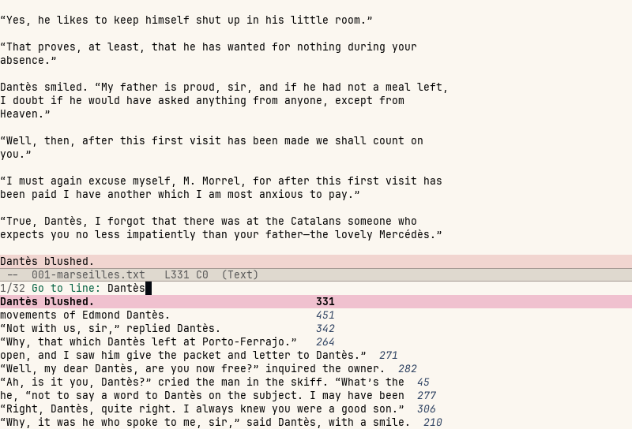
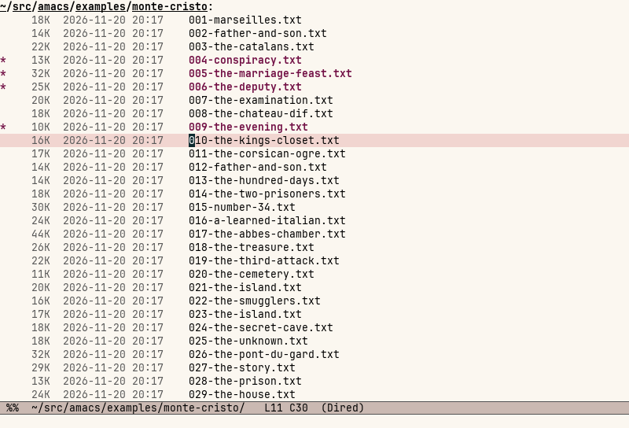
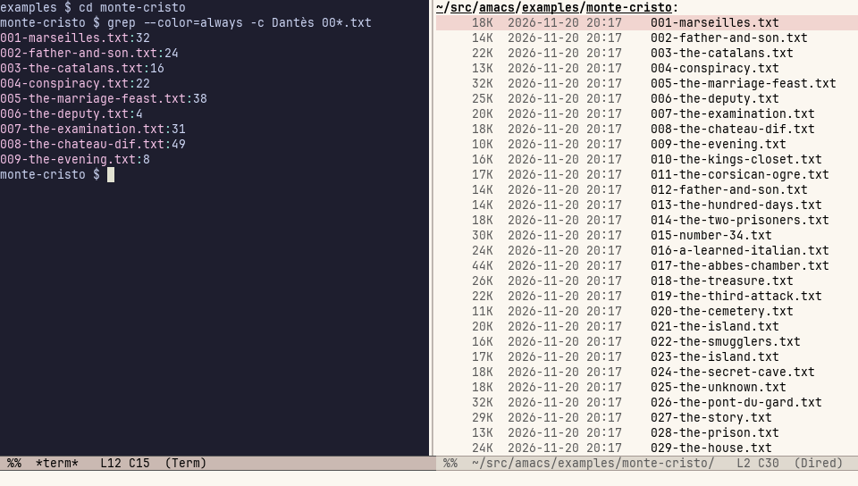

# amacs

An editor like Emacs. The core is written in Rust. Features are written
in Scheme, and you can change them while the editor runs. The Scheme is
the editor's own: see `docs/scheme.md`.

The editor runs as a server. A terminal or a Wayland window connects to
it and shows it.



*A chapter of* The Count of Monte Cristo *in a buffer; `C-s` lists the
lines that contain what is typed, and narrows as it grows.*

## What it can do

Editing:

- Emacs keys: key sequences, prefix arguments, `ESC` as Meta
- The kill ring, the region, rectangles and keyboard macros
- Undo that keeps every change, shown as a tree
- Windows that split, and many buffers
- A minibuffer that lists the candidates and narrows the list as you type
- Jumping to a place on screen by a label
- Line wrapping, tabs, wide characters and emoji

Files:

- Safe saving, with a warning if the file changed on disk
- Auto-save, and recovery after a crash
- A file manager (`C-x d`) and a buffer list grouped by project (`C-x C-b`)
- Files on other hosts over `ssh`, named as tramp names them:
  `/ssh:host:/path`
- A file that is not text is refused, and the editor asks before it reads
  a very large one

Code:

- Syntax highlighting and indentation for 22 languages
- Language servers: errors, completion, go to definition, references,
  rename, code actions and symbols
- Snippets, formatting on save and direnv
- Projects: find a file or search the text in one
- Git (`C-x g`): status, staging by file or by hunk, commits, branches,
  stashes, rebase, logs, blame, and marks beside changed lines
- Paired brackets, and paredit for Lisp

Writing:

- Markdown, with tables that line up and lists that continue
- Spelling in several languages at once, with a wave under wrong words
- The text fields of a web browser, edited here with the GhostText
  extension

Programs inside the editor:

- A terminal (`C-c v`) that runs a shell or any other program
- A coding agent (`C-c c c`): Claude Code, or another agent that speaks
  the Agent Client Protocol

The editor itself:

- A server (`amacs --daemon`) with any number of terminals and windows
- A Wayland window with ligatures, colour emoji, fractional scaling and
  the system clipboard
- The Modus themes
- Scheme for commands, keys, options, hooks, modes and an init file. New
  code works at once, without a restart
- A server for language models (`amacs-mcp`), so that a model can use,
  inspect and change the running editor: see `docs/ai.md`

The sections below describe each of these.

## What is left

The larger things that the editor cannot do yet:

- Org
- On other hosts: programs, language servers and git. Passwords are not
  asked for, so a host must let you in with a key
- Narrowing, `repeat`, renaming a buffer, and regular expressions in `C-s`
- Help in the editor for more than commands and keys
- Reading a large file in the background. Now the editor waits for it
- Drag and drop with other programs
- The mouse in a terminal
- Interactive rebase in git
- Fonts with letters of different widths
- Encrypted files

`TODO.md` has the full list, with the small things.

## Building and running

    nix develop          # Rust, libxkbcommon, libwayland and pkg-config
    cargo build --release
    target/release/amacs FILE...

That builds four programs in `target/release`: `amacs`, the editor in a
terminal and the server; `amacsclient`, which talks to the server;
`amacs-gui`, the Wayland window; and `amacs-mcp`, for language models. With
Nix alone, `nix run . -- FILE` builds and runs the editor, and `nix build`
leaves the programs in `result/bin`.

Keys follow Emacs defaults: `C-x C-f` opens a file, `C-x C-s` saves, `C-x C-c`
quits, `M-x` runs a command by name, `M-:` evaluates a Scheme expression.

Some features run other programs; the rest of the editor works without
them:

| Program | For |
|---|---|
| `rg` (ripgrep) | Listing and searching the files of a project |
| `git` | The git views and the marks in the gutter |
| `wl-copy`, `wl-paste` | The system clipboard |
| `direnv` | The environment of a project's language servers and formatters |
| Language servers and formatters | See "Language servers" |
| `claude-agent-acp` | Claude Code as a coding agent |
| Hunspell dictionaries | Spelling |
| `xdg-open` | Opening what is not text from the file manager |
| `tar`, `zstd`, `gzip`, `xz`, `bzip2`, `zip`, `unzip` | Compressed files and archives in the file manager |

### Installing with Nix

The flake has the package, `packages.<system>.amacs`, and an overlay,
`overlays.default`, that adds it to a nixpkgs as `pkgs.amacs`. Without
installing anything, `nix run github:ast/amacs -- FILE` runs the editor.

In the flake of a NixOS configuration, take it as an input that follows
your nixpkgs, so that it is built with the Rust and the libraries of your
system and no second nixpkgs comes into the lock. It needs Rust 1.95 or
later, which nixos-26.05 has:

```nix
inputs.amacs = {
  url = "github:ast/amacs";
  inputs.nixpkgs.follows = "nixpkgs";
};
```

Then put the overlay among those of the system, in a module that gets
`inputs`, and the package where your programs are listed. With
home-manager's `useGlobalPkgs`, the overlay reaches the home modules too:

```nix
{ inputs, ... }:
{
  nixpkgs.overlays = [ inputs.amacs.overlays.default ];
}
```

```nix
home.packages = [ pkgs.amacs ];          # or environment.systemPackages
```

The lock of your flake says which commit is built; `nix flake update amacs`
moves it. The package is not wrapped: the editor finds `rg`, `git` and the
rest of the table above on the `PATH` it is started with.

To have the server started by systemd when a client first connects, give
systemd the units of the package and enable the socket:

```nix
systemd.packages = [ pkgs.amacs ];
systemd.user.sockets.amacs.wantedBy = [ "sockets.target" ];
```

## A first session

Try the editor with the example configuration, without installing
anything:

    target/release/amacs --init examples/init.scm README.md

Then, for example:

1. `C-s`, type `server`, and move with `C-n` and `C-p` among the lines
   that contain it; `RET` goes to the one selected, `C-g` back.
2. `C-x C-f` and a file of Rust, such as `crates/amacs-text/src/lib.rs`.
   It is highlighted and indented, and rust-analyzer starts if it is
   installed: `M-.` goes to a definition and `M-,` back.
3. `C-c p f` picks any file of the project by part of its name, and
   `C-c /` searches the project as you type.
4. `C-x g` shows the git status; `s` stages the change at point and
   `c c` commits. `C-x d` lists a directory, and `C-x C-b` the buffers.
5. `C-c v` opens a shell in a buffer, and `C-c c c` starts Claude for
   the project, if `claude-agent-acp` is installed.
6. `C-x 2` and `C-x 3` split the window, `M-o` goes to another, and
   `C-x 1` leaves one.
7. `M-:` and `(message "Hello from " (buffer-name))` runs Scheme in the
   editor, and `C-h k` followed by a key says what the key does.
8. `C-x C-c` quits, after asking about buffers that are not saved.

To keep the configuration, copy it to where the editor looks for it, and
change it to taste:

    mkdir -p ~/.config/amacs && cp examples/init.scm ~/.config/amacs/init.scm

For daily use the editor runs as a server, which keeps the buffers while
windows and terminals come and go. A client starts the server if none is
running:

    amacsclient -c README.md       # a window
    amacsclient -t README.md       # this terminal
    export EDITOR=amacsclient      # for git commit and the like

"Server and clients" below has the rest.

## Working on the editor

To work on the editor, `just restart` builds the editor and starts a server
on a socket of its own, `$XDG_RUNTIME_DIR/amacs/dev.sock`, apart from one
that may be running for real work, and `just open FILE` opens a window on
it. The build is the dev profile, with the dependencies and the Scheme
interpreter optimised, so that an edit to Rust is an incremental build and
`cargo test` finds everything built; `AMACS_PROFILE=release just restart`
builds a release instead. `just` alone lists the rest.

With direnv, `direnv allow` once is all it takes: the `.envrc` loads the
flake's shell, puts `target/debug` on the path and points `amacsclient`
at the development server. Without direnv, `nix develop` and
`export AMACS_SOCKET="$XDG_RUNTIME_DIR/amacs/dev.sock"` do the same.

## Choosing things in the minibuffer

A prompt that has candidates lists them under the input. Typing narrows them:
every word must occur in a candidate, in any order, and an uppercase letter
makes the match case-sensitive.

| Key                                      | Does                                                               |
| ---------------------------------------- | ------------------------------------------------------------------ |
| `RET`                                    | Accept the selected candidate; enter a selected directory          |
| `M-RET`                                  | Accept the text as typed, for a new name that matches an old one   |
| `C-n`, `C-p`, `C-v`, `M-v`, `M-<`, `M->` | Move the selection                                                 |
| `TAB`                                    | Put the candidate in the input, to edit it                         |
| `DEL`                                    | After a `/` in a file name, go up a directory                      |
| `M-p`, `M-n`                             | Earlier and later inputs of the same kind                          |
| `C-.`                                    | Act on the candidate another way: copy, insert, kill, other window |

Commands built on it: `M-x`, `C-x C-f`, `C-x b` (buffers and recent files),
`C-s` (lines of the buffer, with a live preview), `C-c /` (the project's
files, with ripgrep, as you type), `C-x C-r` (recent files) and `M-y` (the
kill ring). Scheme code gets the same with `(completing-read prompt list)`.

After a prefix key such as `C-x`, a short pause shows the keys that can
follow. Input history and recent files are kept in `$XDG_STATE_HOME/amacs`.

## Languages

A file's name selects its major mode, which sets the buffer's language. The
language gives it highlighting from a tree-sitter grammar, kept up to date as
you type, and indentation.

Languages: Bash, C, C++, CMake, CSS, Devicetree, Emacs Lisp, Go, HCL and
Terraform, HTML, JavaScript, JSON, Make, Markdown, Nix, Python, Rust, Scheme,
TOML, TSX, TypeScript and YAML. The grammars are compiled into the binary.
Dockerfiles have a mode but no grammar.

| Key                           | Does                                                                |
| ----------------------------- | ------------------------------------------------------------------- |
| `TAB`                         | Indent the line, or the lines of the active region                  |
| `RET`                         | Start a new line, indented; trailing blanks on the old line go      |
| `C-M-\`                       | Indent the region                                                   |
| `C-M-f`, `C-M-b`              | Move over a bracketed expression, string or word                    |
| `C-M-u`, `C-M-d`, `C-M-n`     | Out of the enclosing list backward, into the next list, out forward |
| `C-M-k`, `C-M-DEL`, `C-M-SPC` | Kill the expression after or before point; mark it                  |

How lines are indented depends on the language:

- Languages with brackets are indented from the syntax tree: one level for
  each bracket pair or similar construct that is open at the start of the
  line. Arguments are not lined up under the opening bracket. Where a syntax
  error breaks the tree, the line above decides.
- Lisp is indented as in Emacs: bodies of special forms by two columns,
  arguments under the first argument.
- In Python and YAML the line above decides, and pressing `TAB` again steps
  out one level at a time. `indent-region` refuses to guess there.
- Elsewhere a new line starts where the last one did and `TAB` moves to the
  next tab stop.

The options `indent-offset` and `indent-tabs-mode` are set by each mode and
can be changed in a mode hook. `line-numbers` is `#f`, `'absolute` or
`'relative`.

Two minor modes deal with delimiters:

- `auto-pair-mode` (global) inserts brackets and quotes in pairs, steps over
  a closing delimiter that is typed, deletes an empty pair as one, wraps the
  active region, and opens a block when `RET` is pressed between brackets.
- `paredit-mode` keeps Lisp code balanced. `(`, `[` and `"` insert pairs;
  `)` leaves the list; `DEL`, `C-d` and `C-k` never delete half a pair;
  `C-)` and `C-}` (also `C-<right>`, `C-<left>`) slurp and barf forward,
  `C-(` and `C-{` backward; `M-s` splices, `M-r` raises, `M-(` wraps.

```scheme
(add-hook! 'prog-mode-hook (lambda () (set-local! 'line-numbers 'relative)))
(enable-mode! 'auto-pair-mode)
(add-hook! 'scheme-mode-hook (lambda () (enable-mode! 'paredit-mode)))
```

## Markdown

Markdown is highlighted in two layers: the blocks, and what is within
paragraphs, headings and table cells, such as emphasis, code and links.
The code in a fenced block is highlighted as its language when the fence
names one that the editor knows (` ```rust `, ` ```sh `), front matter as
YAML or TOML, and blocks of HTML as HTML.

| Key                             | Does                                                                                                                       |
| ------------------------------- | -------------------------------------------------------------------------------------------------------------------------- |
| `TAB`, `S-TAB`                  | In a table: line up its columns and go to the next or previous cell; after the last cell, start a new row                  |
| `C-c C-c`                       | Line up the table at point, or tick or clear the box of a list item                                                        |
| `C-c \|`                        | Insert a table                                                                                                             |
| `RET`                           | In a list: start the next item, with the next number and an empty box if the list has them; on an empty item, end the list |
| `C-c C-n`, `C-c C-p`, `C-c C-j` | Next heading, previous heading, a heading chosen by its text                                                               |
| `M-<left>`, `M-<right>`         | Promote or demote the heading at point                                                                                     |

Lining up a table changes its text: every cell of a column is made as wide
as the widest, counted in screen columns, and placed as the row of dashes
says (`:--` left, `--:` right, `:-:` in the middle). It is written in
Scheme, in `runtime/lib/markdown.scm`.

## Language servers

A buffer is attached to a language server when its mode's hook calls
`lsp-ensure`. Servers are started once per project, which is the nearest
directory above the file with a `.git` or `.projectile`, and shared by its
buffers. Programs are set with `lsp-server!`; clangd, rust-analyzer, nixd,
gopls, pyright, terraform-ls and typescript-language-server are known by
default.

```scheme
(lsp-server! "rust" '("rust-analyzer") "{\"check\": {\"command\": \"clippy\"}}")
(add-hook! 'rust-mode-hook lsp-ensure)
```

The third argument is the server's initialization options, as JSON.

| Key | Does |
|---|---|
| `M-.`, `M-,`, `M-?` | Go to the definition; go back; list references |
| `C-M-i` | Complete at point (completions also pop up as you type) |
| `C-c C-r` | Rename the symbol at point in every file |
| `C-c C-a` | Code actions at point or for the region |
| `C-c C-d` | Describe the symbol at point |
| `M-g i`, `C-c C-s` | Go to a symbol of the buffer; find one in the project |
| `M-g n`, `M-g p`, `C-c !` | Next and previous diagnostic; list them |
| `C-x s` | Save every modified file, as after a rename |

Diagnostics are underlined in the text and counted in the mode line, which
also names the server and what it is busy with. When point rests on a
diagnostic its message is shown in the echo area, and otherwise the
signature of the symbol there. `M-x lsp-restart` and `M-x lsp-shutdown` do
what they say; what a server writes to its log and standard error is in the
`*lsp-log*` buffer.

A rename or code action that touches files that are not open opens them.
Nothing is saved until you save.

### Completion

The list of completions appears shortly after two chars of a word are typed,
or at once after a char the server asks for, such as `.`. Typing narrows it;
`C-n` and `C-p` move in it; `RET` or `TAB` inserts the selection; `C-g`
closes it. Without a language server the candidates are the words of the
buffer. The names of the snippets for the mode are always among them. The
options `completion-delay` (milliseconds; negative for never) and
`completion-min-prefix` tune it.

### Snippets

```scheme
(define-snippets 'rust-mode
  `((fn "fn " p "(" p ") {" n> r> n "}")
    (today ,(lambda () (format-current-time "%Y-%m-%d")))))
```

A template is strings and symbols: `p` is a field, `(p "text")` a field
with a placeholder, `(s name)` a field repeated wherever the same name
appears, `q` where point ends up, `n` a line break, `n>` a line break with
indentation and `>` indentation. A procedure is called for its text.
`M-+` expands the snippet named before point or lists those it could be,
and `M-*` inserts one by name. `TAB` and `S-TAB` move between the fields.
Snippets that language servers send with their completions work the same.

### Formatting

```scheme
(format-on-save! 'rust-mode 'rustfmt)
(define-formatter 'clang-format "clang-format" '("--style=llvm" "--assume-filename" "{file}"))
```

A formatter reads the text on standard input and writes it formatted to
standard output. `C-c C-f` formats the buffer; `format-on-save!` also does
so on every save of a mode's buffers. Only the lines that change are
replaced, in one undo step. If the formatter fails the buffer is saved as it
is and the echo area says why. black, clang-format, cmake-format, gofmt,
goimports, nixfmt, prettier, rustfmt, shfmt and tofu-fmt are defined.

### direnv

Language servers and formatters are started with the environment that
`direnv` gives for the file's directory, so a project's `.envrc` (for
example `use flake`) decides which rust-analyzer or clang-format runs. The
editor's own environment does not change. The first file of a project waits
for direnv before its server starts, and the mode line says so. A blocked
`.envrc` is reported; run `direnv allow` and then `M-x direnv-reload` and
`M-x lsp-restart`. Set the option `use-direnv` to `#f` to do without.

## Getting about

**Jumping by label**, as avy does: `M-g c` and a char puts a label on every
place on screen with that char; pressing the label goes there. The nearest
places get one key, the rest two. `M-g w` takes the first char of a word,
`M-g l` labels the lines, and `avy-goto-char-2` takes two chars. `M-z` and
`M-Z` kill from point through, or up to, a char picked the same way.

**Windows**: `M-o` selects another window, by label when there are more than
two. `S-<arrow>` selects the window in that direction. `C-x ^`, `C-x }` and
`C-x {` resize, `C-x +` evens out, and `C-x 4 f` and `C-x 4 b` open a file
or buffer in another window.

**Projects**, with the keys of projectile: `C-c p f` picks a file of the
project, `C-c p p` another project visited before, `C-c p b` one of the
project's buffers, `C-c p k` kills them, and `C-c p s` searches. A project
starts at the nearest directory above a file that holds one of the names in
the `project-root-markers` option (`.git` and `.projectile` unless changed);
language servers start there too. Listing files uses ripgrep, so ignored
files are left out.

**The undo tree**: `M-x undo-tree-visualize` shows the history under the echo
area. Undoing and then editing starts a new branch and keeps the old one.
`b` and `f` step back and forward, `p` and `n` cross to another branch, `q`
keeps the text as it is, and `C-g` returns to where you started.

**Rectangles**: `C-x SPC` marks one, shown as the columns between point and
mark; `C-w` and `M-w` then kill and copy it. With an ordinary region,
`C-x r k`, `C-x r M-w`, `C-x r d`, `C-x r o` and `C-x r t` kill, copy,
delete, open and fill the rectangle between point and mark, and `C-x r y`
yanks the last one.

**Bookmarks**: `C-x r m` names a place in a file and `C-x r b` returns to
one. They are kept across sessions.

**The buffer list**: `C-x C-b` lists the buffers under the project each
belongs to, with point on the one you came from, as ibuffer does. Each
line has the marks, `*` for unsaved changes and `%` for read-only, the
name, the size, the mode and the file. A project folds with `TAB`.

| Key                | Does                                                                |
| ------------------ | ------------------------------------------------------------------- |
| `RET`, `o`         | Switch to the buffer, here or in another window                     |
| `n`, `p`           | Next and previous buffer, over the headings                         |
| `m`, `u`, `U`, `t` | Mark, unmark, unmark all, toggle; on a heading, the whole group      |
| `*`                | Mark by kind: unsaved, in this mode, with or without a file, by name |
| `D`, `k`           | Kill the marked buffers, or this one, after asking                  |
| `d`, `x`           | Flag a buffer to be killed; kill the flagged                        |
| `S`                | Save the marked buffers that have unsaved changes to a file         |
| `s`                | Sort each group by last use, then name, size or mode                |
| `/`, `g`           | Narrow to names and files that contain a text; show all again       |
| `.`                | Show the buffers the editor keeps for itself                        |
| `w`, `q`           | Copy the file names; leave                                          |

Buffers that visit no file are listed under "Other buffers", except those
of the modes in the `ibuffer-project-modes` option, a directory listing or
a git status, which go under their project. The pointer works as in the
file manager: a press goes to a buffer or folds a group, a second press
opens, `C-<mouse-1>` marks and the button for menus lists what can be done.
It is written in Scheme, in `runtime/lib/ibuffer.scm`.

## Files and git

**The file manager**: `C-x d`, or visiting a directory, lists it, with the
keys of dired, and `C-x C-j` lists the directory that the current file is
in, with point on the file. `RET` visits, `^` goes up, `TAB` opens a directory in place,
`/` narrows to the names that contain a text, `.` hides the dot files and
`s` changes the order. `m`, `u`, `U` and `t` mark; `C` copies, `R` moves or
renames and `D` deletes the marked files or the one at point, and with two
listings side by side the other one is offered as where to. `+` makes a
directory, `b` goes to a directory of the `dired-quick-access` option and
`r` to one shown before.



*A directory in the file manager, with four files marked by `m`.*

Opening a file that is not text, such as a picture or a disc image, hands
it to `xdg-open` (the `dired-open-program` option), and `E` does that for
any file.

It works with the pointer too: a second press on a file opens it,
`C-<mouse-1>` and `S-<mouse-1>` mark, the button for menus lists what can be
done, and files are dragged into a directory of a listing or over to
another listing, which moves them, or copies them with Control held. A
press on a part of the directory's name in the first line goes up to that
directory, and so does the back button of a mouse, one level at a time.

**Files on other hosts** have tramp's names: `C-x C-f /ssh:evo:/etc/hosts`
visits a file on the host `evo`, `/ssh:me@evo#2222:notes.txt` one under
the home directory of `me` there, by port 2222, and `C-x d /ssh:evo:`
lists that home directory. At a prompt that already holds a name, typing
`//ssh:` starts the name anew, as `/~` does, so nothing has to be deleted
first. `TAB` completes `/ssh:` to the hosts of `~/.ssh/config` and then
the names on the host.

A name can go on from a host. `/sudo::/etc/hosts` is a file of this
machine as root, `/ssh:evo|sudo::/etc/nixos` one on `evo` as root there,
`/ssh:evo|sudo:postgres@:` the home directory of another user, and
`/ssh:gate|ssh:evo:/etc` a host that is reached through another. None of
this has to be remembered. The prompt offers what can come next at each
point, with a few words beside it: after `/` the ways to a place and the
places used before, after `/ssh:` the hosts that `ssh` knows, each with
what `~/.ssh/config` says of it and whether it is connected, and after a
host its top and home directories, `|sudo::` "Become root on that host."
and `|ssh:` "Connect from that host to a different host." `RET` takes one
and goes on from it. Above them a row says the name in plain words, "Host
evo. Then user root. Path: /etc/nixos", or what to type next. `M-x sudo-edit` skips all of
it for the usual case: it visits the file of the current buffer again as
root, on whatever host it is, with point where it was.

Such a file is a file like any other: it is edited, saved with `C-x C-s`,
and read again when it changes there, and `C-x C-j` lists its directory.
In the file manager, `C`, `R`, `D` and `+` work on the host, and with a
listing of this machine beside one of a host, `C` and `R` carry files
from one to the other, directories with what is in them. All of it
happens in the background: the editor does not stand still for a slow
line, and says so within seconds when a host does not answer.

Nothing is installed on the host. The editor runs `ssh` itself and talks
SFTP to it, so what `ssh host` needs to work in a terminal is all that is
needed: the user's `~/.ssh/config`, keys, agent and jump hosts apply.
That configuration is read first and wins. Where it sets up control
connections (`ControlMaster`, `ControlPath`), the editor uses the same
ones as the terminal does, so a host that a terminal is logged in to
opens at once, and the other way round. Where it does not, the editor
keeps one connection per host of its own, for ten minutes after its last
use. Compression and the like are the configuration's to set. Hosts that
are gone through are treated the same. For now the
host must be one that `ssh` reaches without asking anything, with a key
or an agent and a host key that is known already, and `sudo` must ask no
password there: because it never does, or because it was used in a
terminal a moment ago. Not there yet either: programs on the host, so a
remote buffer has no `M-!`, terminal, git, formatter or language server.

The methods are not built in. `ssh`, `sudo`, `podman` and `docker` are
each a few lines of `runtime/lib/remote.scm`: a command line with holes
for the host, the user and the port, and the sentences that the prompt
shows. `/podman:name:/path` and `/docker:name:/path` reach a container
that has the `sftp-server` program in it. Another method is defined the
same way in the init file; this one is `doas`:

    (define-remote-method "doas"
      'command '("doas" "-n" "-u" user "--")
      'host 'optional 'user "root" 'stays #t
      'here "Become a different user on this machine with doas."
      'there "Become a different user on that host with doas."
      'usage "Type doas:: for root.")

What the prompt offers is Scheme too (`remote-name-offers`), and so is
the row that says a name in words: any prompt can be given such a row,
by a function on `prompt-change-hook` that calls `set-prompt-hint!`. `(remote-hosts)` lists the connections and
`(remote-disconnect "/ssh:evo:")` ends one.

**Git**: `C-x g` shows the status of the repository of the current buffer,
in sections that `TAB` folds. `s` and `u` stage and unstage the file or hunk
at point, `k` discards it, and `RET` goes to the change. `c` commits, `b`
is for branches, `P`, `F` and `f` push, pull and fetch, `z` stashes, `r`
rebases and `l` shows the log; each opens a menu of what it can do.
`M-x git-blame` shows who last changed each line, and `git-gutter-mode`
marks the changed lines of a file beside their numbers.

Both are written in Scheme, in `runtime/lib/dired.scm` and
`runtime/lib/git.scm`; `docs/extending.md` has all their keys and the parts
that other code can use.

## The terminal

`C-c v` opens a terminal: a shell on a pseudo-terminal, its screen shown in
an ordinary buffer, as eat and vterm do in Emacs. `C-c V` opens one in
another window. Both go to a terminal already running in the project, or
start a shell; with a prefix argument they always start another. Full
programs run in it: `vim`, `htop`, `less`, and a language model's terminal
interface.

The screen is a buffer, and the lines that scroll off the top stay in it
as text (`term-scrollback-lines`, 10000). Keys go to the program, `C-c`,
`C-s` and `M-w` among them, except those of the `term-emacs-keys` option
(`C-x`, `M-x`, `M-:`, `M-o`, `C-u`, `C-v`, `M-v`, `M-<`, `M->` and the
shifted arrows), so the editor's own commands still work; this is eat's
semi-char mode. One key is the terminal's own,
as the prefix key of tmux: `C-q`, the `term-escape-key` option. It leads to
the terminal's commands, and sends a reserved key to the program: `C-q C-x`
sends `C-x`, `C-q C-q` sends `C-q` itself. `C-q C-y` sends the last kill,
and `<paste>` is sent as a bracketed paste.

For a program that needs the reserved keys all the time, such as a shell
with its own `C-x`, a full-screen editor or tmux, `C-q C-k` enters char
mode, where every key but `C-q` goes to the program; the mode line shows
`Char`, and `C-q C-k` returns to semi-char mode.

To search the screen and what scrolled off it, and to copy from it, `C-q
C-t` (or `C-q [`, as in tmux) enters copy mode, as vterm's: no key goes to
the program, so every key means what it does in any buffer, `C-s` to
search, `C-SPC` and `M-w` to select and copy, and point stays where you
put it while the program writes. The mode line shows `Copy`. `q` or `C-q
C-t` returns to the program, in the mode the terminal was in, and so does
anything sent to the program: `C-q C-y`, a paste, `C-q C-l`.

| Mode | Keys | The editor's keys |
|---|---|---|
| semi-char, at the start | | `term-emacs-keys` and `C-q` |
| char | `C-q C-k` | `C-q` |
| copy | `C-q C-t`, `C-q [`; `q` leaves | all |

Outside copy mode too, point follows the program's cursor only until you
move it away, with `M-<` or `M-v`; `C-q C-l` brings it back, and so does the next key sent to the
program. The terminal takes the size of the window that shows it. The
program runs with `TERM=xterm-256color`, `COLORTERM=truecolor`, `AMACS=1`
and the editor's socket in its environment. The sixteen ANSI colours come
from the theme (the `fg-term-*` palette entries); the rest are xterm's.
Truecolor, bold, italic, underline and inverse all show.

A terminal buffer is in the directory that its shell is in: after a `cd`
in the shell, `C-x C-f` and `C-x d` start from there. The editor asks the
system where the shell is each time it writes, which needs Linux and no
set-up of the shell; it does not see a `cd` in a shell on another machine.

`C-q C-d` (`term-dired`) shows that directory in the file manager, in a
window beside the terminal, and the window follows the shell from then on:
each `cd` shows the new directory. The terminal leads. Moving about in the
listing leaves the shell where it is, and `c` there sends the shell to the
directory at point with a `cd` typed at its prompt. The window follows
until it is closed or shows something else.



*A shell in a terminal buffer, after `C-q C-d`: the listing on the right
followed the shell into the directory of the chapters, and the shell's
colours show.*

To give terminals a colour scheme of their own, apart from the editor's
theme, set the `term` face and the `fg-term-*` palette entries in
`init.scm`:

```scheme
;; The background and foreground of terminal buffers.
(set-face! 'term 'bg "#1e1e2e" 'fg "#cdd6f4")
;; The sixteen colours that programs name, normal then bright.
(set-palette-overrides!
  '((fg-term-black "#45475a") (bg-term-black "#45475a")
    (fg-term-red "#f38ba8") (fg-term-green "#a6e3a1")
    (fg-term-yellow "#f9e2af") (fg-term-blue "#89b4fa")
    (fg-term-magenta "#f5c2e7") (fg-term-cyan "#94e2d5")
    (fg-term-white "#bac2de") (fg-term-black-bright "#585b70")))
```

It is written in `runtime/lib/term.scm`, on the `amacs-term` crate and the
process and span primitives of the core; the listing that follows is
`runtime/lib/term-dired.scm`.

## Coding agents

A coding agent lives in the editor over the Agent Client Protocol
(agentclientprotocol.com), the standard way editors drive agents, as Zed
and others do. Claude Code speaks it through the `claude-agent-acp` adapter,
which uses your own `claude` login; other agents speak it too, so the layer
is not tied to one.

`C-c c c` starts Claude for the project and shows two windows: the
conversation above and a compose buffer below. Write a prompt in the compose
buffer, as long as you like, and `C-c C-c` sends it. `M-p` and `M-n` walk
earlier prompts, `C-c C-k` clears the buffer. From a file you are reading,
select some code and `C-c c r` adds a reference to it (`@path#L3-9`) to the
prompt. The agent reads and writes files through the editor, so it sees your
unsaved edits.

You need not wait for the agent to write the next prompt. One sent while it
is at work waits its turn: the conversation shows it as waiting, and it is
sent when the turn is over. `C-c C-s` sends the prompt into the turn that
is going on instead, to change its course, with an agent that takes such, as
Claude does. `C-c c k` stops the turn, and what waited is not sent; `M-p`
brings it back.

An image is named in a prompt as a file is: `@shot.png`, written by hand or
put there by `C-c c i` (`C-c C-a` in the compose buffer), which asks for the
file. The image is sent with the prompt for the model to see: png, jpg, gif
and webp.

When the agent wants leave to change a file or run something, it does not
take the minibuffer from you. The tool call says that it asks leave and
lists the answers the agent offers, each with a key; the echo area and the
mode line say so too. Answer when it suits, from any buffer: `C-c c y`
allows it this once, `C-c c n` refuses, and `C-c c o` shows every answer in
a menu of keys, such as allowing it always. In the conversation, `y` and `o`
do the same, and `RET` on an answer gives it.

`C-c c m` sets the mode (plan, accept edits and so on), the model, or
whatever else the agent lets be set: choose which, then its value, from what
the agent tells of. `C-c c /` sends one of the agent's slash commands,
chosen by name, and asks for what the command takes if it takes something.

The conversation is a buffer of sections, as the git buffers are. Each
prompt heads a turn, and under it comes the answer as it streams, coloured
as Markdown; what the agent thought, folded away; each tool call with its
state, which changes where it stands, and under it what the tool wrote or
the change it made to a file, as a diff; and the plan as a list that is
ticked off. `TAB` folds and opens what is at point, and `RET` on a tool call
or on a line of a change goes to the file at that line. The window follows
the end of the answer until you move point up to read, and follows again
when point is back at the end. The mode line names the model and the mode,
says how much of the model's context is used, and says when the agent is at
work.

There can be several sessions at once, each with an agent, a conversation
and a compose buffer of its own: `*claude*`, `*claude*<2>` and so on. `C-c c
c` goes to the session of the project you are in and starts one if there is
none; with a prefix argument, `C-u C-c c c`, it starts another. `C-c c b`
goes to another session, chosen by name, with where it works, what it is
doing and the title of its conversation beside it. A command is about the
session whose buffer it is given in, or else the one of the project. `C-c c
y` and `C-c c n` answer whichever session asks.

Conversations outlive their agents. `C-c c R` lists the conversations that
were had in the project, the latest first with their titles, as Claude Code
keeps them, those of its own terminal interface among them; the one you
choose is shown again from its start and goes on. `C-c c f` starts another
session from the one you are in, as it is now, and leaves that one alone: a
way to try something else from here. An agent that was stopped (`M-x
claude-quit`) or that ended takes its conversation up where it was when `C-c
c c` is pressed in it.

A session might go like this:

1. In a file of the project, `C-c c c`. The conversation says "Ready."
   and point is in the compose buffer.
2. `C-c c m`, `Mode`, `Plan`: the agent is to plan and change nothing.
   The mode line of the conversation now says so.
3. `C-x o` back to the file, select a function, and `C-c c r`. The
   compose buffer gets `@src/parser.rs#L40-72`.
4. In the compose buffer, write "Why does this allocate for every token?
   Propose a fix." after the reference, and `C-c C-c`.
5. Read the answer as it comes. `TAB` on "Thinking" opens what the agent
   thought, and `RET` on a tool call goes to the file it read.
6. `C-c c m`, `Mode`, `Manual`, and a new prompt: "Do it." When the tool
   call that edits the file says "asks leave", look at the diff under it
   and press `C-c c y`, or `C-c c n` to refuse.
7. `C-c c /` and `/compact` when the conversation has grown long.
   `C-c c k` stops a turn that has gone astray.

| Key                     | Does                                                                                 |
| ----------------------- | ------------------------------------------------------------------------------------ |
| `C-c c c`               | Start Claude for the project, or show its windows; with `C-u`, start another session |
| `C-c c b`               | Go to another session                                                                |
| `C-c c R`               | Take up a conversation that was had in the project before                            |
| `C-c c f`               | Start another session from this one as it is                                         |
| `C-c c p`               | Show the compose buffer                                                              |
| `C-c C-c`               | In the compose buffer, send the prompt, or have it wait for the turn to end          |
| `C-c C-s`               | In the compose buffer, send the prompt into the turn that is going on                |
| `C-c C-k`               | Clear the compose buffer                                                             |
| `C-c c i`, `C-c C-a`    | Add an image to the prompt                                                           |
| `M-p`, `M-n`            | Earlier and later prompts                                                            |
| `C-c c r`               | Add a reference to the region of the current file to the prompt                      |
| `C-c c l`               | Ask a one-line question in the minibuffer                                            |
| `C-c c k`               | Cancel the current turn                                                              |
| `C-c c y`, `C-c c n`    | Allow once, or refuse, what the agent asks leave for                                 |
| `C-c c o`               | Every answer to what the agent asks leave for, in a menu of keys                     |
| `C-c c m`               | Set the mode, the model or another option of the session                             |
| `C-c c /`               | Send a slash command                                                                 |
| `TAB`                   | In the conversation, fold or open the section at point                               |
| `RET`                   | In the conversation, go to the file and line at point, or give the answer at point   |
| `y`, `o`, `m`, `/`, `b` | In the conversation, as `C-c c` and the same key                                     |
| `M-n`, `M-p`            | In the conversation, the next and the previous turn                                  |
| `g`                     | In the conversation, draw it again                                                   |

The adapter comes from `claude-agent-acp`; set `acp-command` if it is
elsewhere. It is written in `runtime/lib/acp.scm`, on the process and JSON
primitives and on `runtime/lib/section.scm`. An agent that has no shell of
its own can have the editor run programs for it (the protocol's
`terminal/*`), and the tool call shows what they write; Claude Code runs its
own.

An agent has the Model Context Protocol servers of its own configuration.
The `acp-mcp-servers` option gives it more with each session, a command or
the URL of a server that speaks HTTP, and `acp-additional-directories`
directories to work in besides that of the project:

```scheme
;; A program that speaks the protocol, and a server on the network.
(set-option! 'acp-mcp-servers
  '(("amacs" "amacs-mcp")
    ("docs" "https://example.org/mcp")))
(set-option! 'acp-additional-directories '("/home/me/src/other"))
```

Not there yet: other agents than Claude by name, and what belongs to Claude
Code's own terminal interface, such as going back to a checkpoint.

## Spelling

The misspelled words on screen have a wave under them: all of the text in
prose, and the comments and strings in code. `M-$` or `C-.` corrects the one at
point, or else the nearest: choose among what the dictionaries suggest, or
type what it should be. `C-M-$` goes through all of the buffer.

| In the list of `M-$` | Does |
|---|---|
| a suggestion, or text of your own | Puts it in the word's place |
| `@word` | Saves the word in your own list, `~/.config/amacs/spelling/words` |
| `*word` | Accepts the word until the editor exits |
| `+word` | Saves the word in `.spelling` at the root of the project |

The dictionaries are those of Hunspell, an `.aff` and a `.dic` file for
each language, found where `DICPATH` says and in `hunspell` under the
system's data directories. A buffer can be in several languages, and a
word is right if one of them knows it:

```scheme
(set-option! 'spell-languages '("en_US" "sv_SE"))
```

`M-x spell-set-languages` chooses them for one buffer. Words are looked up
in a thread of their own, so drawing never waits for a dictionary: a word
seen for the first time is marked a moment later, and the word being typed
not until it is left. The words glued to digits or to the punctuation of
code, addresses, file names and words all in capitals are not checked.
`docs/extending.md` has the rest; the commands are in
`runtime/lib/spell.scm`.

## Smaller things

Four minor modes lay marks over the text. Turn them on in a mode hook with
`(enable-mode! 'hl-line-mode)` and so on:

| Mode | Marks |
|---|---|
| `hl-line-mode` | The line point is on |
| `symbol-highlight-mode` | The other occurrences of the symbol at point |
| `hl-todo-mode` | TODO, FIXME, NOTE and their kin, in comments |
| `whitespace-mode` | Trailing whitespace and text past `whitespace-line-column` |

A fifth changes how long lines are shown: in `visual-line-mode` a line too
long for the window is broken between words, where it is otherwise broken
at the window's edge with a `\\`. The text itself is not changed. The
conversation with an agent and its compose buffer are shown so; for prose
of your own, turn it on in a hook:

```scheme
(add-hook! 'markdown-mode-hook (lambda () (enable-mode! 'visual-line-mode)))
```

`symbol-next` and `symbol-previous` step through the occurrences of the
symbol at point, and `symbol-rename` renames it throughout the buffer.

A buffer without changes is read again when another program changes its
file, within five seconds; the echo area says so. Set the `auto-revert`
option to `#f` to stop that. `M-x revert-buffer` does it on demand.

Editing: `M-%` query-replace, `M-;` comment or uncomment the region or line,
`move-text-up` and `move-text-down`, `M-u`, `M-l` and `M-c` for letter case,
`C-x C-u` and `C-x C-l` for the region, `M-m`, `M-^`, `M-\` and `M-SPC`,
`C-x C-q` read-only, `M-!` and `M-|` for shell commands (with `C-u`, the
output replaces the region), and `scroll-up-line` and `scroll-down-line`.
`C-h k` says what a key runs and `C-h f` what a command does.

The smaller commands of Emacs are there under their names and keys. They
are written in Scheme, in `runtime/lib/simple.scm`:

| Key | Does |
|---|---|
| `C-x i` | Insert a file at point; `M-x insert-buffer` a buffer |
| `C-t`, `M-t`, `C-x C-t` | Transpose chars, words, lines |
| `C-S-DEL` | Kill the whole line; `M-x duplicate-line` copies it |
| `C-x C-o` | Delete blank lines; `M-x delete-trailing-whitespace` |
| `M-q` | Fill the paragraph to the `fill-column` option (70) |
| `M-h`, `M-@` | Mark the paragraph, the word |
| `M-=`, `C-x =` | Count lines, words and chars; say what is at point |
| `C-x C-e` | Evaluate the Scheme expression before point; `M-x eval-region`, `M-x load-file` |
| `C-x r SPC`, `C-x r j` | Keep the place of point in a register; go to it |
| `C-x r s`, `C-x r i` | Keep the region in a register; insert it |
| `C-q` | Insert the char of the next key: `C-q TAB` |
| `C-x <left>`, `C-x <right>` | The previous and the next buffer, by name |
| `C-M-v`, `C-M-S-v` | Scroll the other window |
| `C-h e` | Show the messages |

By name: `sort-lines`, `reverse-region`, `delete-duplicate-lines`,
`flush-lines` and `keep-lines` work on the lines of the region or of the
buffer, the last two by a regular expression; `replace-string` replaces
every occurrence from point on, or in the region; `what-line`, `pwd` and
`cd`.

`C-M-%` is `query-replace-regexp`: as `M-%`, for the matches of a regular
expression, and the question shows what each match becomes. `M-x
replace-regexp` replaces them all without asking, `M-x count-matches`
counts them. The expressions are those of Rust's `regex` crate, not of
Emacs: groups are `(…)` and alternatives `a|b` without backslashes, `\d`
and `\w` are there, and `^` and `$` are the starts and ends of lines. Case
matters; start with `(?i)` for it not to. In a replacement `\&` is what
matched and `\1` to `\9` what a group matched. For code there are
`(regexp-search regexp string)` and `(regexp-replace regexp string
replacement)`.

Keyboard macros keep what you type to type it again. `F3` (or `C-x (`)
starts one, and the mode line says `Def`; `F4` (or `C-x )`) ends it. `F4`
(or `C-x e`) then types its keys again: with `C-u 5`, five times, and with
`C-u 0` until a command fails, as moving past the last line does, which is
how a macro is run over the rest of a buffer. What is typed in the
minibuffer is part of the macro. `M-x name-last-kbd-macro` makes a command
of the last macro, and `(execute-kbd-macro "C-a - SPC C-n")` types keys
from code.


## Text fields of a web browser

A text field of a web page can be edited here instead of in the page,
where the site decides what the keys do. The browser's side is the
[GhostText](https://ghosttext.fregante.com/) extension, for Firefox and
Chrome; the editor's side is `M-x ghost-text-start`, or in the init file:

```scheme
(ghost-text-start)
```

In the browser, put the cursor in a field and press the extension's button
or its key, `Ctrl-Shift-H` on Linux unless changed. The field comes up in
a buffer named after the site, with the cursor where it was in the page.
What is typed in the buffer is in the page a moment later, and what is
typed in the page is in the buffer, so nothing has to be saved or sent.
The extension also knows the editors that sites build themselves, such as
CodeMirror and Monaco.

| Key | Does |
|---|---|
| `C-c C-c`, `C-x #` | Hand the field back to the browser, which shows its page again |
| `C-c C-k` | Hand it back with the text it had when the editing began |

Killing the buffer hands the field back as well, and a field that the
browser closes, as when its page is left, takes its buffer along.
`M-x ghost-text-stop` stops listening.

| Option | Says |
|---|---|
| `ghost-text-new-window` | Whether a field gets a window of its own, which closes when the field is done; otherwise it is shown in the frame last used |
| `ghost-text-modes` | The major mode for the fields of a site: lists of a regular expression for the host and a mode. GitHub, GitLab, Reddit and Stack Overflow are Markdown |
| `ghost-text-default-mode` | The mode for the other sites: `text-mode` |
| `ghost-text-port` | The port to listen on: 4001, which is what the extension asks unless its options say otherwise |
| `ghost-text-origins` | What the origin of a program that connects must start with: the extensions of browsers |
| `ghost-text-delay` | For how many milliseconds changes are collected before they are sent: 50 |

```scheme
(set-option! 'ghost-text-new-window #t)
(set-option! 'ghost-text-modes
  (cons '("(^|\\.)example\\.org$" markdown-mode) (option 'ghost-text-modes)))
```

One editor can listen on the port at a time; a second one, such as the
server of a development build, says that the port is taken. The editor
listens to this machine only, and of what a browser runs it serves the
extensions and not the pages: any page can ask a browser to connect to a
port of the machine it runs on. `runtime/lib/ghost-text.scm` is the code,
on top of `make-websocket-server`, which `docs/extending.md` describes.

## Themes

Faces take their colours from the palette of the current theme. The four
Modus themes are built in: `modus-operandi`, `modus-vivendi` and their
`-tinted` variants; `modus-operandi-tinted` is the default. The palettes are
those of the modus-themes package for Emacs by Protesilaos Stavrou, which is
licensed under the GPL, version 3 or later.

```scheme
(load-theme 'modus-vivendi-tinted)
;; Replace palette entries in every theme.
(set-palette-overrides! '((comment yellow-faint) (string green-warmer)))
;; Change one face. Colours are palette names or "#rrggbb".
(set-face! 'keyword 'fg 'magenta 'bold #f)
;; A theme of your own, starting from another.
(define-theme 'mine 'modus-vivendi '((bg-main "#101418")))
```

`M-x toggle-theme` switches between the themes in the `themes-to-toggle`
option, and `M-x choose-theme` picks one by name. The faces are listed in
`crates/amacs-core/src/faces.rs`; the syntax faces are `comment`, `doc`,
`string`, `escape`, `regexp`, `constant`, `number`, `keyword`, `operator`,
`bracket`, `delimiter`, `function-name`, `function-call`, `builtin`,
`preprocessor`, `type`, `variable-name`, `property`, `heading`, `emphasis`,
`strong`, `code` and `link`.

## Server and clients

`amacs --daemon` runs the editor without a terminal. `amacsclient` talks to it
and starts it if it is not running:

    amacsclient -t [FILE]...       # open a frame in this terminal
    amacsclient -c [FILE]...       # open a frame in a new window
    amacsclient FILE               # visit FILE and wait until C-x # finishes it
    amacsclient -n FILE            # visit FILE and return at once
    amacsclient +12:4 FILE         # go to line 12, column 4
    amacsclient --eval '(buffer-list)'
    amacsclient --kill-server      # stop the server, as after rebuilding

A client and a server from different builds may not understand each other;
the client then says so, and `amacsclient --kill-server` stops the old
server so that the next client starts a new one. It asks the server to
terminate, which makes it auto-save unsaved buffers first.

`EDITOR=amacsclient` works for `git commit` and the like: without `-t`, the
file opens in a frame that some client already has, or else in this terminal.
In a client frame, `C-x C-c` closes that frame only; `M-x kill-editor` stops
the server.

The socket is `$XDG_RUNTIME_DIR/amacs/server.sock` (override with
`AMACS_SOCKET` or `-s`). The Nix package installs systemd user units,
`amacs.service` and a socket-activated `amacs.socket`.

Modified buffers that visit files are auto-saved to
`$XDG_STATE_HOME/amacs/auto-save` after five idle seconds, every thirty
seconds while busy, and when the server is asked to stop or crashes. Visiting
a file that has auto-save data says so; `M-x recover-this-file` restores it.
The visited file itself is only ever written by saving.

## The Wayland window

`amacsclient -c` (or `amacs-gui` directly) opens a window on the server. With
`-n` it returns at once and the window stays; without, it lasts until the
files are finished or the window is closed.

The font comes from two options, for example in `init.scm`:

```scheme
(set-option! 'font-family "JetBrainsMono Nerd Font Mono")
(set-option! 'font-size 16)   ; pixels, before the output's scale
```

`--font` and `--font-size` override them for one window. The default family,
`monospace`, is whatever fontconfig says it is.

Text can also be drawn for each part of a pixel by itself, which is three
times the resolution across at the price of coloured fringes on the edges
of glyphs. Some eyes prefer it on a screen of low density, others do not.
It takes knowing the order of the parts, which compositors rarely do; most
screens are `rgb`:

```scheme
(set-option! 'subpixel-order "rgb")   ; or "bgr"; "none" is shades of grey
```

`--subpixel` overrides it for one window. The GPU renderer needs a GPU that
blends with two sources, which every desktop GPU does; without one it draws
in shades of grey.

The options are read when a window opens; changing them does not affect
windows that are already open.

Text is shaped per run, so programming ligatures form, and then placed on
the cell grid.

Drawing is in parts (`crates/amacs-gui/src/render/`): what the server said
to show, the fonts, a list of the rectangles and glyphs that each row is
made of, and a backend that puts the list on screen. There are two
backends, which give the same picture.

The one that is used unless another is asked for draws on the CPU into
memory shared with the compositor, repainting only what changed. The other
draws with the GPU, through Vulkan, the whole frame each time from an atlas
of glyphs. An option chooses it for every window:

```scheme
(set-option! 'gpu-renderer #t)
```

and for one window, whatever the option says:

    amacs-gui --renderer gpu FILE
    AMACS_RENDERER=cpu amacsclient -c FILE

It says on standard error which GPU it draws with, or that it draws on the
CPU after all and why, as when there is no Vulkan.

The server reaches the system clipboard through `wl-copy` and `wl-paste`, for
terminal frames too: a kill is copied, and `C-y` yanks what another program
copied last. This needs `WAYLAND_DISPLAY` in the server's environment.

A click puts point there and selects the window, and the wheel scrolls the
window under the pointer. Dragging with the button held selects text, as
the region; a second click takes the word and a third the line, and
dragging on from there adds to it. Past the top or bottom of the window the
text follows the pointer.

Buttons are keys, `<mouse-1>` to `<mouse-3>` and what is done with them
held, so modes and the init file bind them as they bind other keys:
`docs/extending.md` says how.

Not there yet: the mouse in the terminal, dragging to and from other
programs, input methods and compose
sequences, and a native clipboard without the helper programs.

## Scheme

The init file is `$XDG_CONFIG_HOME/amacs/init.scm`. `examples/init.scm` is a
starting point:

```scheme
(set-option! 'tab-width 4)

(define-command (insert-date)
  "Insert today's date as YYYY-MM-DD."
  (insert (format-current-time "%Y-%m-%d")))

(global-set-key "C-c d" 'insert-date)

(define-command (greet)
  "Ask for a name and insert a greeting."
  (insert "Hello, " (read-string "Name: ")))

(add-hook! 'scheme-mode-hook (lambda () (set-local! 'tab-width 2)))
```

The primitives are listed with their documentation in
`crates/amacs-script/src/api.rs`. The rest of the Scheme API (`define-command`,
`define-major-mode`, `add-hook!`, `read-string`, `deftest` and so on) is
written in Scheme under `runtime/core/`, and the language modes under
`runtime/modes/`. Things to know:

- Buffer positions are zero-based.
- A prompt such as `read-string` suspends the command until the user answers.
  It works inside commands and hooks, not at the top level of a file.
- Primitives act on the current buffer, which is that of the selected window
  unless `(with-current-buffer name ...)` says otherwise.
- Hooks run after the event that triggered them, not in the middle of it,
  except `pre-command-hook` and `before-save-hook`, which the command or the
  save waits for.
- Options hold data (numbers, strings, symbols, lists), not procedures.

Useful flags: `--init FILE`, `-q` (no init file), `-l FILE`, `--eval EXPR`, and
`--batch` to run without a terminal.

## Testing

    cargo test                                   # unit, end-to-end and property tests
    amacs --batch -q -l runtime/tests/core.scm --test   # Scheme tests only
    cargo test --release -- --ignored large_file # 100 MB file round trip
    cargo deny check                             # dependency policy
    nix flake check                              # build, tests, clippy, rustfmt

End-to-end tests drive the editor through a headless frontend
(`crates/amacs-testkit`): they press keys and assert on the resulting screen.
The language server tests run against a small server of their own
(`crates/amacs-testkit/examples/fake-lsp.rs`) that speaks the real protocol.

## Layout

| Crate               | Role                                                                         |
| ------------------- | ---------------------------------------------------------------------------- |
| `amacs-text`        | Rope, markers, undo tree                                                     |
| `amacs-proto`       | Keys, input events and draw operations shared with frontends                 |
| `amacs-treesit`     | Grammars, highlighting queries and indentation rules                         |
| `amacs-lsp`         | Language Server Protocol transport, positions and URIs                       |
| `amacs-core`        | Editor state, commands, keymaps, redisplay                                   |
| `amacs-tty`         | Terminal frontend                                                            |
| `amacs-server`      | The `amacs` binary: standalone editor, server, batch mode                    |
| `amacs-client`      | The `amacsclient` binary and the connection code                             |
| `amacs-gui`         | The `amacs-gui` binary: the Wayland window and its renderer                  |
| `amacs-term`        | A terminal's screen as rows of text with faces, on Alacritty's state machine |
| `amacs-remote`      | Files on other hosts: tramp's file names, and an SFTP client over a program  |
| `amacs-gpu-surface` | The one unsafe call, which hands a GPU's driver a Wayland window             |
| `amacs-scheme`      | The editor's own Scheme: reader, compiler, virtual machine                   |
| `amacs-script`      | Editor primitives for Scheme, and the session that runs the two together     |
| `amacs-mcp`         | The `amacs-mcp` binary: a Model Context Protocol server for language models  |
| `amacs-testkit`     | Headless frontend for tests                                                  |

`runtime/` holds the part of the editor written in Scheme, and its tests.

`docs/scheme.md` describes the editor's own Scheme, `docs/extending.md` how
to extend the editor with it, and `docs/ai.md` how language models use,
inspect and change the running editor.
